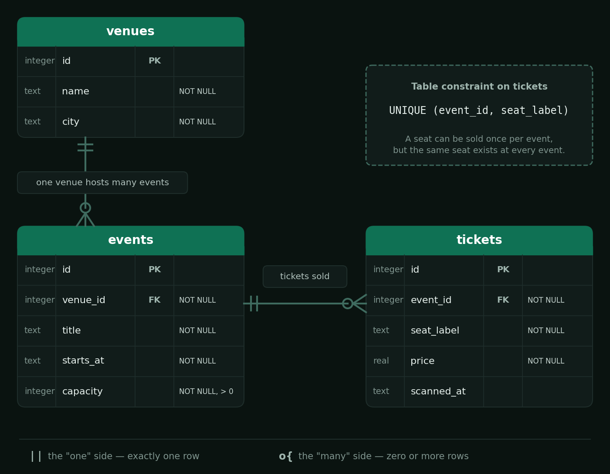

# Summative Assessment

## Learning Outcomes

| Learning Outcome | Section |
|---|---|
| Project Management / Agile | Section 1 |
| OOP / Greenfield Development | Section 2 |
| Brownfields Development | Section 3 |
| Build Pipelines / Scripting | Section 4 |
| Relational Database Design | Section 5 |
| Testing / Systems Design | Section 6 |
| Web Development | Section 7 |

---

## Duration

**Total time: 3 hours**

| Section | Recommended Time |
|---|---|
| Section 1 — Project Management | 20 minutes |
| Section 2 — OOP and Greenfield Development | 40 minutes |
| Section 3 — Brownfields Development | 15 minutes |
| Section 4 — Build and Release Management | 25 minutes |
| Section 5 — Database Schema Design | 20 minutes |
| Section 6 — Testing and Systems Design | 25 minutes |
| Section 7 — Web Development | 35 minutes |

---

## Scoring

| Section | Marks |
|---|---|
| Section 1 — Project Management | 13 |
| Section 2 — OOP and Greenfield Development | 20 |
| Section 3 — Brownfields Development | 8 |
| Section 4 — Build and Release Management | 13 |
| Section 5 — Database Schema Design | 10 |
| Section 6 — Testing and Systems Design | 16 |
| Section 7 — Web Development | 20 |
| **Total** | **100** |

To pass, your final score must be **60% or higher**.

---

## The Scenario

**TicketWave** is a South African ticketing company. It sells tickets to concerts and sports
matches, checks people in at the gate, and refunds tickets when plans change. Sections 1 to 6 of
this assessment are about a part of TicketWave's software. Section 7 uses examples from the
Web Development curriculum.

This repository is **one Maven project**: `ticketing-service`, TicketWave's ticketing software.

| Package (under `src/main/java/za/co/wethinkcode/ticketing/`) | What it is | Used in |
|---|---|---|
| `sales/` | A brand-new ticket sales module that you build from scratch | Section 2 |
| `model/`, `service/` | The existing refund rules, written by a previous team | Sections 3 and 6 |
| `Main`, `Database`, `DatabaseSchema`, `pom.xml`, pipeline | The application's entry point, database and build | Sections 4 and 5 |

Q7.1 uses a separate starter module, `webdev/`, which is not part of the Maven project.

The project compiles from the start, before you change anything, so you can complete the
sections in any order. **Keep it compiling as you work.** A compile error anywhere stops
every test in the project from running.

Write all written answers in `answers.txt`, under the matching question heading. Do not
change the format of the file or create a new one.

---

# Section 1 — Project Management

## Scenario

ING Netherlands — Agile at Scale

ING Netherlands is the Dutch part of a global bank. In June 2015 it began introducing a new way
of working at its headquarters. Instead of organising people into functions that handed work to
one another, the bank grouped them into small **squads** of about nine people, each made up of a
mix of skills (for example marketing, product and IT), and gathered the squads into larger groups
called **tribes**. Before rolling the model out widely, ING started with five or six pilot squads
and used what it learned to adjust the set-up.

The scale grew quickly. The new model came to comprise about 350 squads in 13 tribes, and the first
wave covered some 3,500 people at the group headquarters; support functions such as HR, finance
and risk were originally left out. ING's leaders reported that the new approach had improved the
time it takes to bring products to market, raised employee engagement and increased productivity.

You have been brought in as project manager for a new TicketWave team about to build a product
called **TicketWave Live Entry**. Gate staff will scan a ticket's QR code on their phones and see
straight away whether the holder is admitted, holds an invalid ticket, is trying to enter twice,
or has gone to the wrong gate. Ticket holders will see an accurate status in their own app.

Your first responsibility, before any code is written, is to set the team's way of working.

> **Reference:** Jacobs, P., and Schlatmann, B. (interview conducted by D. Mahadevan).
> *ING's agile transformation.* McKinsey Quarterly. Available at mckinsey.com.

| Task | Marks | What earns marks |
|---|---|---|
| Q1.1 — Waterfall vs Agile | 4 | Accurate definition of both (2), clear reasoning that explains why small, multidisciplinary teams working in short cycles would be expected to improve time to market (2) |
| Q1.2 — Establishing a way of working | 6 | Relevant guardrails, each explained (what it is, when it happens, what problem it prevents), that together give the team a complete, repeatable process |
| Q1.3 — Forecasting with velocity | 3 | Accurate explanation of velocity and how to forecast with it (2), a correct warning about how it should not be used (1) |

---

### Q1.1 — Waterfall vs Agile *(4 marks)*

Define and contrast the Waterfall model and Agile (time-boxed) delivery. Assume that before
the change, ING's work moved in phases between separate specialist groups, as it does in many large
organisations. Explain why organising people into small, multidisciplinary teams that deliver
in short cycles would be *expected* to improve the time it takes to get a product to market.

---

### Q1.2 — Establishing a Way of Working *(6 marks)*

You have just joined the Live Entry team, and nobody has agreed how the team will work together
yet. Developers pick up whatever they like, nobody can see who is working on what, requirements
arrive by email, and problems are only discovered when someone happens to mention them.

What basic guardrails would you put in place so that the team has a clear, repeatable process
of working? For each guardrail, explain:

- what it is,
- when or how often it happens, and
- what problem it prevents for this team.

Include how the team will see the progress of every piece of work, from the moment it is
requested to the moment it is finished. Also say how the team will **inspect and adapt** its own
process over time, as ING did when it began with a few pilot squads.

---

### Q1.3 — Forecasting with Velocity *(3 marks)*

The team has completed 18, 22 and 20 story points in its last three sprints. The remaining
backlog for the first release is 120 points, and a manager asks, "So when will it launch?"

Explain what **velocity** is and how you would use it to give the manager a forecast. Then
explain why the team's velocity should not be used as a target to be pushed up, or to compare
this team with other teams.

---

# Section 2 — OOP and Greenfield Development

## Scenario

TicketWave is adding a new **ticket sales** module to `ticketing-service`, built from scratch.
Every ticket has an id, a holder, a seat, a price, and whether it has been used at the gate.
Tickets are sold in three kinds (General, VIP and Season pass), and each one prices itself and
sends its holder to a different gate. VIP tickets and Season passes can be refunded; General
tickets cannot.

All of the work for this section is in the `sales` package.

| Task | Marks | What earns marks |
|---|---|---|
| Q2.1 — Implementation | 12 | `(sales tests passed / total sales tests) × 12` |
| Q2.2 — The pillars of OOP | 8 | Names and correctly defines each of the four pillars (1 each), explains how to recognise each one in a codebase with a correct example from the `sales` package (1 each) |

### Class Hierarchy

```
Ticket  (abstract)
├── GeneralTicket
├── VipTicket      implements Refundable
└── SeasonPass     implements Refundable

Interface: Refundable      (provided — do not modify)
```

### Package Structure

```
src/
  main/java/za/co/wethinkcode/ticketing/sales/
    Refundable.java        (provided)
    Ticket.java
    GeneralTicket.java
    VipTicket.java
    SeasonPass.java
    BoxOffice.java
  test/java/za/co/wethinkcode/ticketing/sales/
    TicketTest.java
    TicketTypesTest.java
    RefundableTest.java
    BoxOfficeTest.java
    Types.java
```

The skeleton classes already contain their constructors and public methods, so the project
compiles. Each method body is a placeholder that throws `UnsupportedOperationException`.
**The design is yours to complete:** declare the fields, decide what is `abstract`, add the
`extends` and `implements` relationships, call `super(...)`, and replace every placeholder
with a real implementation, as described below. The tests check all of these.

> **Do NOT modify any test files or `Refundable.java`.**

Run only this section's tests with:

```bash
mvn test -Dtest='za.co.wethinkcode.ticketing.sales.*Test'
```

---

### Q2.1 — Implementation *(12 marks)*

Work through the steps **in order**. Each class builds on the ones before it.

#### Step 1 — Read `Refundable` (Interface — provided)

**File:** `sales/Refundable.java`

| Method | Details |
|---|---|
| `refundAmount()` | Returns the amount, in Rands, that the holder gets back if the ticket is refunded (`double`). |
| `refundWindowDays()` | Returns how many days before the event a refund can still be requested (`int`). |

---

#### Step 2 — Implement `Ticket` (Abstract)

**File:** `sales/Ticket.java`

`Ticket` is the root of the hierarchy. It holds the state every ticket shares, but it cannot
price a ticket or choose a gate on its own. Every ticket object must have its own state.

##### Fields

| Field | Type | Details |
|---|---|---|
| `ticketId` | `String` | Private and **immutable** |
| `holderName` | `String` | Private and **immutable** |
| `seatLabel` | `String` | Private |
| `price` | `double` | Private. The face value of the ticket. Must always be greater than `0`. |
| `used` | `boolean` | Private. Starts as `false`. |

##### Constructor

Accepts `ticketId`, `holderName`, `seatLabel`, `price`. Throws `IllegalArgumentException` if
`price` is zero or negative. Sets `used` to `false`.

##### Methods

| Method | Details |
|---|---|
| `getTicketId()` | Returns the ticket id. No setter. |
| `getHolderName()` | Returns the holder's name. No setter. |
| `getSeatLabel()` <br/> `updateSeatLabel(String)` | Getter and updater. The updater throws `IllegalStateException` if the ticket has already been used. |
| `getPrice()` <br/> `updatePrice(double)` | Getter and updater. The updater throws `IllegalArgumentException` if the value is zero or negative, and must leave the price unchanged when it does. |
| `isUsed()` <br/> `markUsed()` | Returns whether the ticket has been used. `markUsed()` sets it to `true`. |
| `toString()` | Returns a summary that includes the ticket id and the holder's name. |
| `totalCost()` | **Abstract.** Returns the total the customer pays, in Rands. |
| `entryGate()` | **Abstract.** Returns the gate the holder must use. |
| `ticketClass()` | **Abstract.** Returns a short label for the kind of ticket. |

---

#### Step 3 — Implement `GeneralTicket`, `VipTicket`, `SeasonPass`

All three extend `Ticket` and implement every abstract method. Use the `@Override` annotation
on every overridden method.

##### `GeneralTicket`

| | Details |
|---|---|
| Extends | `Ticket` |
| Extra fields | None |
| Constructor | Accepts all `Ticket` parameters |
| `totalCost()` | `price + BOOKING_FEE` |
| `entryGate()` | Returns `ENTRY_GATE` |
| `ticketClass()` | Returns `"General"` |
| `toString()` | Includes `"General"` and the parent summary |

##### `VipTicket`

| | Details |
|---|---|
| Extends / implements | `Ticket`, `Refundable` |
| Extra fields | `perks (String)`: private and **immutable**; getter `getPerks()`. |
| Constructor | Accepts all `Ticket` parameters, then `perks`. |
| `totalCost()` | `price × (1 + VIP_SURCHARGE) + BOOKING_FEE` |
| `entryGate()` | Returns `ENTRY_GATE` |
| `ticketClass()` | Returns `"VIP"` |
| `refundAmount()` | The **current** `price × REFUND_RATE` (it must follow later price updates) |
| `refundWindowDays()` | Returns `REFUND_WINDOW_DAYS` |
| `toString()` | Includes `"VIP"`, the parent summary and the perks |

##### `SeasonPass`

A season pass covers several events. Its `price` is the price **per event**.

| | Details |
|---|---|
| Extends / implements | `Ticket`, `Refundable` |
| Extra fields | `eventCount (int)`: private and **immutable**; getter `getEventCount()`. |
| Constructor | Accepts all `Ticket` parameters, then `eventCount`. Throws `IllegalArgumentException` if `eventCount` is less than `1`. |
| `totalCost()` | `price × eventCount × (1 − SEASON_DISCOUNT)` |
| `entryGate()` | Returns `ENTRY_GATE` |
| `ticketClass()` | Returns `"Season"` |
| `refundAmount()` | `totalCost() × REFUND_RATE` |
| `refundWindowDays()` | Returns `REFUND_WINDOW_DAYS` |
| `toString()` | Includes `"Season"`, the parent summary and the event count |

> The constants (`BOOKING_FEE`, `VIP_SURCHARGE`, `REFUND_RATE` and so on) are already declared
> in each skeleton file.
>
> **Hint:** inside a subclass, `price` is private to `Ticket`, so use `getPrice()`.

---

#### Step 4 — Implement `BoxOffice`

**File:** `sales/BoxOffice.java`

`BoxOffice` ties the system together: it holds every ticket sold at a venue and reports on them.

##### Fields

| Field | Type | Details |
|---|---|---|
| `venueName` | `String` | Private and immutable. |
| `tickets` | `List<Ticket>` | Private. Every ticket sold at this venue. |

##### Constructor

Accepts `venueName`. Initialises `tickets` as an empty `ArrayList`.

##### Methods

| Method | Details |
|---|---|
| `getVenueName()` | Returns the venue name. |
| `addTicket(Ticket)` | Adds a ticket. Throws `IllegalArgumentException` if a ticket with the same ticket id is already present. |
| `findTicket(String ticketId)` | Returns the `Ticket`, or `null` if not found. |
| `getTickets()` | Returns a list that callers cannot modify. |
| `refundableTickets()` | Returns a **new** `List<Refundable>` holding every ticket that is `Refundable`. *(Hint: `instanceof`.)* |
| `totalRevenue()` | Sums `totalCost()` across all tickets. Returns `0.0` if there are none. It must give the same answer every time it is called. |
| `totalRefundLiability()` | Sums `refundAmount()` across all refundable tickets. Returns `0.0` if there are none. |

---

### Q2.2 — The Pillars of OOP *(8 marks)*

Object-oriented programming rests on four key pillars.

For **each** of the four pillars:

1. Name it and define it in your own words.
2. Explain how you would identify it when reading a codebase: what keywords, structures or
   patterns tell you it is being used?
3. Point to one place in the `sales` package where it appears (name the class and the
   field, method or declaration) and explain briefly why that is an example of the pillar.

---

# Section 3 — Brownfields Development

## Scenario

The `model` and `service` packages hold TicketWave's existing refund rules, written by a
team that has since moved on. `RefundRulesService` decides whether a booking can be refunded
(`canRefund`) and what should happen next at the gate (`nextStep`). It works, and
`RefundRulesServiceTest` covers it, but both methods are hard to read, and the business wants
new refund rules added next sprint.

Read `RefundRulesService` before you answer. **You do not change any code in this section.**
Both answers go in `answers.txt`.

| Task | Marks | What earns marks |
|---|---|---|
| Q3.1 — Refactoring | 3 | Accurate definition (1), clear distinction from other kinds of change (1), a relevant example from `RefundRulesService` (1) |
| Q3.2 — Changing code safely | 5 | Names and explains a suitable development approach (2), describes each stage of its cycle correctly (2), applies it to the example rule (1) |

---

### Q3.1 — Refactoring *(3 marks)*

Your team lead asks you to refactor `RefundRulesService` before any new rules are added.

Explain what refactoring is, and how it differs from fixing a bug or adding a feature. Use one
of the two methods in `RefundRulesService` as an example of code that would benefit from it,
and say what you would want to improve.

---

### Q3.2 — Changing Code Safely *(5 marks)*

The team lead adds a condition: no customer or gate staff member may notice any change in
behaviour while you restructure the code, and the new rules the team adds next sprint must be
built in a way that keeps that true for the next team as well.

The first new rule is: *a booking worth more than R2 000 cannot be refunded unless a second staff
member has approved the refund.*

Describe the development approach you would follow, both while you restructure the existing
code and when you add this new rule. Name the approach and explain why it keeps behaviour safe.
Then walk through each stage of the cycle it follows, saying what you would do at each stage
for the R2 000 rule and how you know when to move on to the next stage.

---

# Section 4 — Build and Release Management

## Scenario

`ticketing-service` is built with Maven, and its `Makefile` has the targets you can run locally:
`make compile`, `make test` and `make package`. The team is getting ready to release and needs a
GitLab CI pipeline.

| Task | Marks | What earns marks |
|---|---|---|
| Q4.1 — Releasing a snapshot | 4 | Correct explanation of `-SNAPSHOT` and why it must not reach customers (1), correct release version (1), justification that addresses each change (2) |
| Q4.2 — "It builds, but it won't run" | 4 | Correctly explains why the tests can reach the database driver but the packaged jar cannot (2), fix applied so the packaged jar runs and creates `ticketing.db` (2) |
| Q4.3 — Complete the pipeline | 3 | The pipeline runs the required jobs in the required order (1), the built jar can be downloaded once the pipeline finishes, and is kept for one week (1), a correct explanation of why the order matters (1) |
| Q4.4 — The `pom.xml` file | 2 | Correct explanation of what the file is for (1), two things this project's `pom.xml` defines, each with what Maven does with it (1) |

---

### Q4.1 — Releasing a Snapshot *(4 marks)*

Open `pom.xml`. The project's version is `2.7.0-SNAPSHOT`. The last version released to
customers was `2.6.4`.

**Q4.1.1** Explain what the `-SNAPSHOT` suffix means and why a snapshot build should never be
handed to customers.

**Q4.1.2** Since `2.6.4`, the following changes have been merged:

- A rounding defect in `VipTicket.refundAmount()` was fixed.
- A new class, `WaitingList`, was added. No existing code changed.
- The public method `BoxOffice.totalRevenue()` was renamed to `grossRevenue()`. A partner
  team's integration still calls `totalRevenue()`.

The team plans to release this as `2.7.0`. Is that the correct version? State the version you
would release and justify it with reference to **each** of the three changes.

---

### Q4.2 — "It Builds, But It Won't Run" *(4 marks)*

Package the application and run it:

```bash
make package
java -jar target/ticketing-service-jar-with-dependencies.jar
```

The build succeeds, and the application prints two lines and then crashes. Yet the tests in
`DatabaseSchemaTest` can open a database connection on the same machine without any problem.

Find the cause in `pom.xml` and fix it so that the packaged jar runs to the end and creates
`ticketing.db`. In `answers.txt`, explain why the tests could reach the database driver but the
packaged jar could not.

> Do not change any Java code to fix this.
>
> You can look up artefacts on [Maven Central](https://mvnrepository.com/repos/central).

---

### Q4.3 — Complete the Pipeline *(3 marks)*

`.gitlab-ci.yml` has been started for you. Complete it so that the pipeline:

1. **compiles** the code,
2. then **runs the test suite**,
3. then **packages** the application, and keeps the built jar so it can be downloaded from the
   pipeline page once the pipeline finishes. The jar should be kept for **one week**.

Each job should run the matching `Makefile` target. Then, in `answers.txt`, explain why the
pipeline must run these steps in this order.

> You are allowed to use the [GitLab CI/CD YAML docs](https://docs.gitlab.com/ci/yaml/).

---

### Q4.4 — The `pom.xml` File *(2 marks)*

Every Maven project, including `ticketing-service`, has a `pom.xml` at its root.

Explain what the `pom.xml` file is for: what would a team have to do by hand, on every machine
and in the pipeline, if the project did not have one? Then point to **two** different things
this project's `pom.xml` defines, and explain what Maven does with each of them.

---

# Section 5 — Database Schema Design

## Scenario

TicketWave needs to store its venues, the events held at each venue, and every ticket sold for
each event. `resources/erd.png` is the entity relationship diagram for the three tables you
need to create:



A `Database` class is already provided and knows how to open a JDBC connection to a SQLite
database. `DatabaseSchema.createSchema(Connection connection)` is where the schema itself is
created, but the method body is currently empty.

> `resources/SQL-Cheat-Sheet.pdf` is provided as a reference if you need a refresher on SQL
> syntax (data types, constraints, `CREATE TABLE`, etc.).

| Task | Marks | What earns marks |
|---|---|---|
| Q5.1 — Tables, columns and types | 3 | All three tables created with exactly the columns and types in the ERD (1 per table) |
| Q5.2 — Primary keys and NOT NULL | 2 | `id` is the primary key of every table (1), `NOT NULL` applied exactly as in the ERD, and nowhere else (1) |
| Q5.3 — Foreign keys | 2 | `events.venue_id` references `venues.id` (1), `tickets.event_id` references `events.id` (1) |
| Q5.4 — Seats and capacity | 3 | The table constraint on `tickets` declared (1), the capacity rule on `events` declared (1), written explanation (1) |

---

### Q5.1 – Q5.3 — Create the Schema *(7 marks)*

Implement `DatabaseSchema.createSchema(Connection connection)` so that it creates the
`venues`, `events` and `tickets` tables exactly as shown in the ERD, using standard SQL
`CREATE TABLE` statements executed through the JDBC `Connection` you are given.

> This task is schema creation only — you are not inserting or querying any data.
>
> Think about the order in which the tables must be created.
>
> Run `mvn test -Dtest=DatabaseSchemaTest` to check your schema.

---

### Q5.4 — Seats and Capacity *(3 marks)*

The ERD shows two rules that the **database** must enforce, not just the Java code:

- A seat can only be sold once for a given event, although the same seat label exists at every
  event. Declare the table constraint shown in the ERD on `tickets`.
- An event's capacity must be greater than zero. Make the database enforce it.

Then, in `answers.txt`: every ticket already has a seat label that is unique within its event,
so a teammate asks why `tickets` needs a separate `id` column at all. Explain the difference
between a `PRIMARY KEY` and a `UNIQUE` constraint, and give one reason why `id` is a better
primary key than `(event_id, seat_label)`. *(Think about `Ticket.updateSeatLabel`.)*

---

# Section 6 — Testing and Systems Design

| Task | Marks | What earns marks |
|---|---|---|
| Q6.1 — Types of Testing | 4 | Each of the three checks correctly classified with a justification (1 each), explanation of what the third check confirms that the other two cannot (1) |
| Q6.2 — Diagramming and UML | 4 | Intention of diagramming (1), what UML is and what it is for (1), correct structural/behavioural classification (1), which diagram answers the developer's question and why (1) |
| Q6.3 — UML Class Diagram | 8 | Both classes with correct fields, visibility and methods (3), relationship with correct multiplicity (2), written explanation of how a one-to-many relationship is represented in objects and in tables (3) |

---

### Q6.1 — Types of Testing *(4 marks)*

TicketWave runs three checks before a release:

1. `RefundRulesServiceTest` — the existing tests for the refund rules from Section 3. They
   create `Booking` and `Customer` objects in memory and call one method of
   `RefundRulesService` at a time.
2. `DatabaseSchemaTest` — opens a real SQLite connection through `Database`, runs
   `DatabaseSchema`, and then inspects the tables that were created in the database.
3. A release check run by the QA team on a staging copy of the live system. Following a script
   agreed with the business, a tester buys a VIP ticket on the website, scans its QR code at a
   test gate, confirms the holder is admitted, and then confirms a second scan is flagged as a
   duplicate. The team has no knowledge of how the code is written.

Name the type of testing each check represents and justify each classification. Then explain
what the third check confirms that the first two cannot.

---

### Q6.2 — Diagramming and UML *(4 marks)*

Before you draw anything in Q6.3, answer the following in `answers.txt`:

**Q6.2.1** What is the intention of diagramming when designing or documenting software? Why do
teams draw diagrams instead of only reading the code?

**Q6.2.2** What is UML (Unified Modeling Language), and what is its intention?

**Q6.2.3** UML diagrams fall into two broad categories, *structural* and *behavioural*.
Explain the difference, and place each of these in the correct category: a class diagram, a
sequence diagram, and a use-case diagram.

**Q6.2.4** A new developer asks, "What happens, step by step, between a gate scanner sending a
scan and the holder's app showing *Admitted*?" Which diagram would you draw to answer that, and
why would a class diagram not answer it?

---

### Q6.3 — UML Class Diagram *(8 marks)*

Produce a UML class diagram of these two classes from the `ticketing-service` `model` package:
`Booking` and `GateScan`. (You do not need to include `Customer`, `TicketCategory` or
`ScanOutcome`. Where a field or method uses one of those types, just write the type name, in
the same way you would write `String`.)

Your diagram must show:

- Each class name
- All fields with their types and access modifiers (`+` public, `-` private, `#` protected)
- All methods with their return types and parameters
- The relationship between the two classes, with multiplicities on each end

Draw your diagram as **PlantUML text** (or ASCII art) in `answers.txt`, under Question 6.3.

Then, in `answers.txt`: your class diagram describes a one-to-many relationship (one booking,
many gate scans) and the ERD in Section 5 describes another (one event, many tickets). Explain
how a one-to-many relationship is represented in Java objects, how it is represented in database
tables, and which side "holds" the relationship in each.

---

# Section 7 — Web Development: The Whole Stack

## Scenario

Show that you understand how the web works: how a browser loads and runs a page, how a web
application handles requests and remembers its users, and where a page's work can happen.

Q7.1 has starter code in the `webdev/` module. It is not part of the Maven project, so nothing
in it is compiled or run by `mvn` or the pipeline. Q7.2 and Q7.3 are written questions about
concepts: you do not read or write any code for them, but you must apply each idea to the
situation described.

| Task | Marks | What earns marks |
|---|---|---|
| Q7.1 — The browser side | 6 | Q7.1.1: the script works as described (2). Q7.1.2: an accurate, complete and correctly ordered walkthrough that explains why each step happens (4) |
| Q7.2 — How a web application remembers you | 8 | Accurate explanation of each concept, applied to the TicketWave journey: Q7.2.1 (2), Q7.2.2 (2), Q7.2.3 (3), Q7.2.4 (1) |
| Q7.3 — Server-side, client-side and single page | 6 | Accurate explanation of each concept, applied to the seat map: Q7.3.1 (2), Q7.3.2 (2), Q7.3.3 (2) |

---

### Q7.1 — The Browser Side *(6 marks)*

Here is the ticket picker's page, `webdev/ticket-picker/index.html`:

```html
<!DOCTYPE html>
<html>
    <head>
        <title>Pick a ticket</title>
        <link rel="stylesheet" href="css/styles.css"/>
        <script src="js/picker.js" defer></script>
    </head>
    <body>
        <h1>Choose your ticket</h1>
        <p>Click a ticket type, then check the total below.</p>
        <ul id="ticket-types">
            <li data-name="General" data-price="350">General: R350 each</li>
            <li data-name="VIP" data-price="1500">VIP: R1500 each</li>
            <li data-name="Season pass" data-price="400">Season pass: R400 per event</li>
        </ul>
        <label>Quantity
            <input type="number" id="quantity" value="1" min="1"/>
        </label>
        <p id="summary"></p>
    </body>
</html>
```

**Q7.1.1** Complete `webdev/ticket-picker/js/picker.js` so that clicking a ticket type in the
list shows the choice and the total in the empty paragraph:

- It shows `You chose`, the ticket type's name, `x`, the quantity, then `:` and the total
  price in Rands, for example `You chose VIP x 2: R3000`. The name and price come from the
  `data-name` and `data-price` attributes of the item that was clicked.
- If the quantity is not a whole number of at least `1`, it shows
  `Please enter a quantity of at least 1` instead.
- Clicking somewhere in the list that is not one of the ticket types does nothing.

Do not change `index.html`. You can open `index.html` in a browser to try it.

**Q7.1.2** Walk through what happens, from the browser's first HTTP request until clicking
"VIP" shows "You chose VIP x 2: R3000" on the page.

---

### Q7.2 — How a Web Application Remembers You *(8 marks)*

A customer opens TicketWave, enters their email address and password on the login page, clicks
Login, and lands on a page listing their own tickets. Later they pick a VIP ticket and click
**Pay now**.

**Q7.2.1** When the customer clicks Login, the browser sends the form to the server. Explain the
difference between an HTTP **GET** and an HTTP **POST** request, and say which one the login
form and the **Pay now** button should use, and why. *(2 marks)*

**Q7.2.2** HTTP is described as **stateless**. Explain what that means. Then explain how
TicketWave can still know which customer is asking for the "my tickets" page, even though it is
a separate request from the login. *(2 marks)*

**Q7.2.3** TicketWave also offers a JSON API for its mobile app. For each of the following,
give the HTTP method, a sensible URL path, and the status code the server should return, with a
one-line reason: *(3 marks)*

1. The app lists the upcoming events.
2. The app buys a ticket for event 12.
3. The app asks to refund ticket 77, but that ticket has already been scanned at the gate.

**Q7.2.4** After a successful payment, the server tells the browser to go to a confirmation
page instead of returning the confirmation page straight away. Explain why web applications do
this. *(1 mark)*

---

### Q7.3 — Server-Side, Client-Side and Single Page *(6 marks)*

For a popular concert, TicketWave shows a seat availability page at `/events/12/seats`. It
lists the event's title and price list, and a map of which seats are still free. The page could
be generated on the server, generated in the browser, or built as a single page application.

**Q7.3.1** Explain **server-side page generation**, **client-side page generation**, and a
**single page application (SPA)** for this page. For each, say where the work happens and what
the browser receives. *(2 marks)*

**Q7.3.2** In the client-side approach, the browser asks the server for the seats as data rather
than as a finished page. Explain what an **API endpoint** is, and why it usually returns its
data as JSON rather than HTML. *(2 marks)*

**Q7.3.3** The business now has two requirements for this page:

1. The seat map must show seats sold to other customers within about ten seconds, without the
   whole page reloading.
2. The event title and price list must still be readable by search engines and by customers
   whose browsers have JavaScript switched off.

For each requirement, say which approach meets it and justify your choice. Is there a way to
meet both? *(2 marks)*

---

### End of Assessment

---

## Repository Structure

```
.
├── README.md
├── answers.txt
├── pom.xml
├── Makefile
├── .gitlab-ci.yml
├── resources/
│   ├── erd.png
│   └── SQL-Cheat-Sheet.pdf
├── webdev/                  # Section 7 starter module — separate from the Maven project
│   └── ticket-picker/       # Q7.1 — index.html and css provided; you complete js/picker.js
├── src/
│   ├── main/java/za/co/wethinkcode/ticketing/
│   │   ├── Main.java
│   │   ├── Database.java
│   │   ├── DatabaseSchema.java
│   │   ├── sales/               # Section 2 — Ticket hierarchy, Refundable, BoxOffice
│   │   ├── model/               # Sections 3 and 6 — Booking, Customer, GateScan, TicketCategory, ScanOutcome
│   │   └── service/             # Section 3 — RefundRulesService (read only)
│   └── test/java/za/co/wethinkcode/ticketing/
│       ├── DatabaseSchemaTest.java
│       ├── sales/               # Section 2 tests
│       └── service/RefundRulesServiceTest.java
```

## Useful Commands

```bash
# Compile the source code
mvn compile

# Run every test
mvn test

# Run only one section's tests
mvn test -Dtest='za.co.wethinkcode.ticketing.sales.*Test'   # Section 2
mvn test -Dtest=RefundRulesServiceTest                      # Section 3 / Q6.1
mvn test -Dtest=DatabaseSchemaTest                          # Section 5

# Package the application into a jar (does not run the tests)
make package

# Run the packaged jar
java -jar target/ticketing-service-jar-with-dependencies.jar
```

The `Makefile` wraps the same commands, and is what your GitLab CI pipeline should run:

```bash
make compile
make test
make package
```

---

**NOTE:** Before pushing your solution for grading, make sure it compiles by running
`mvn clean compile test-compile`. If it does not compile, no tests can run, and that will
cost you marks in every section.
